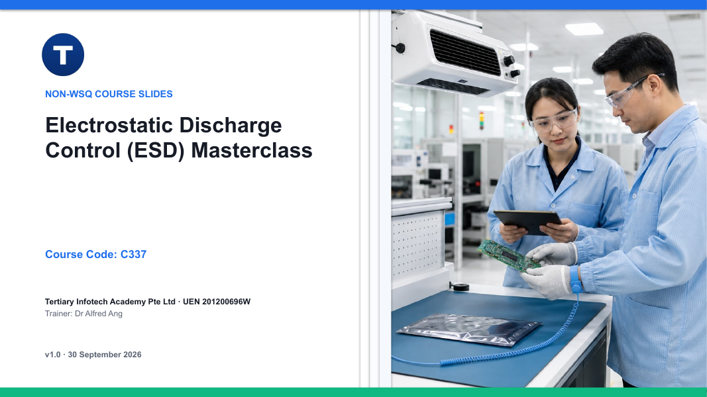

# Electrostatic Discharge Control (ESD) Masterclass

A one-day, hands-on masterclass on preventing, controlling, verifying and improving electrostatic discharge (ESD) protection in labs and factories.

| Course detail | Information |
|---|---|
| Course code | `C337` |
| Programme | Non-WSQ |
| Duration | 1 day, 9:30am – 5:30pm (7.5 instructional hours) |
| Registration | [View course details and register](https://www.tertiarycourses.com.sg/electrostatic-discharge-control-esd-masterclass.html) |

## About the course

ESD damage is invisible: a device can be destroyed or latently weakened without a spark or a felt shock. This course builds the complete ESD control picture for engineers, supervisors and managers — from the physics of charge generation and the HBM/MM/CDM discharge models, through Electrostatic Protected Area (EPA) design, grounding, ionisation and packaging, to standards-based verification, auditing, incident investigation and CAPA. Eight scenario-based activities apply each module to realistic lab and factory situations.

## Learning outcomes

- LO1: Apply control measures to manage ESD generation based on ESD principles.
- LO2: Evaluate and recommend actions to improve ESD control effectiveness in accordance with ESD standards.

## Topics covered

1. **Module 1: Basics of ESD** — charge generation, discharge paths, HBM/MM/CDM, failure modes, business impact
2. **Module 2: ESD Control Principles, Equipment and Practices** — EPA design, grounding and bonding, personnel controls, ionisation, packaging, maintenance
3. **Module 3: ESD Standards, Testing and Auditing** — control programme structure, measurements, compliance verification, evidence, performance metrics
4. **Module 4: Training, Awareness and Incident Improvement** — competence, behaviour, reporting, root-cause analysis, CAPA, management ownership

## Activities

Each activity is a self-contained folder under [`activities/`](activities/) with a scenario, learner procedure, worksheet, evidence requirements and acceptance checklist, in Markdown and PDF.

1. [Activity 1: Static Hazard Hunt at NovaSense Incoming Inspection](activities/activity-01-static-hazard-hunt-at-novasense-incoming-inspection/README.md)
2. [Activity 2: Medical Microchip Failure Triage: ESD, EOS or Process Defect?](activities/activity-02-medical-microchip-failure-triage-esd-eos-or-process-defect/README.md)
3. [Activity 3: Design and Commission an EPA for Orion Optics](activities/activity-03-design-and-commission-an-epa-for-orion-optics/README.md)
4. [Activity 4: Select Controls for the Aster Robotics Handling Cell](activities/activity-04-select-controls-for-the-aster-robotics-handling-cell/README.md)
5. [Activity 5: Execute a Compliance Verification Round](activities/activity-05-execute-a-compliance-verification-round/README.md)
6. [Activity 6: Standards-Based EPA Audit at Helix Assembly](activities/activity-06-standards-based-epa-audit-at-helix-assembly/README.md)
7. [Activity 7: Investigate the PulseMed ESD Incident](activities/activity-07-investigate-the-pulsemed-esd-incident/README.md)
8. [Activity 8: Management Capstone: Build the Apex ESD Control Plan](activities/activity-08-management-capstone-build-the-apex-esd-control-plan/README.md)

## Courseware package

| Artifact | Files |
|---|---|
| Trainer slides | [PPTX](courseware/Electrostatic%20Discharge%20Control%20(ESD)%20Masterclass-v1.0.pptx) · [PDF](courseware/Electrostatic%20Discharge%20Control%20(ESD)%20Masterclass-v1.0.pdf) |
| Learner Guide | [DOCX](courseware/LG-Electrostatic%20Discharge%20Control%20(ESD)%20Masterclass.docx) · [PDF](courseware/LG-Electrostatic%20Discharge%20Control%20(ESD)%20Masterclass.pdf) · [Markdown](LG-Electrostatic%20Discharge%20Control%20(ESD)%20Masterclass.md) |
| Lesson Plan | [DOCX](courseware/LP-Electrostatic%20Discharge%20Control%20(ESD)%20Masterclass.docx) · [PDF](courseware/LP-Electrostatic%20Discharge%20Control%20(ESD)%20Masterclass.pdf) |

## Distribution boundary

This public repository carries the learner-facing courseware and activities. Build tooling and trainer-only source material are not published.

---

© Tertiary Infotech Academy Pte Ltd · UEN 201200696W · [www.tertiarycourses.com.sg](https://www.tertiarycourses.com.sg/)
